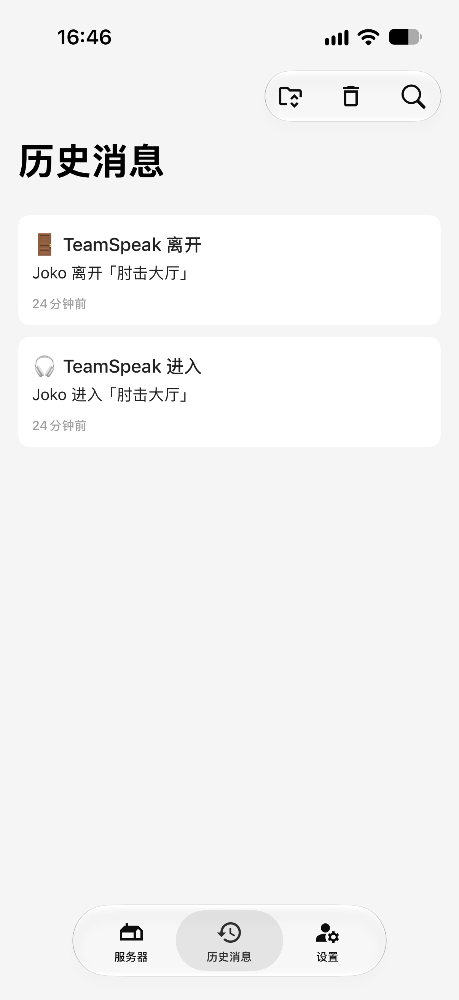

# ts3-bark


将 TeamSpeak 3 的客户端登录、退出事件实时推送至 Bark（iOS）。适用于自建 TS3 服务器。

- 镜像：`docker pull sdparklab/ts3-bark`（[Docker Hub](https://hub.docker.com/r/sdparklab/ts3-bark)）
- 源码：[github.com/sdparklab/ts3-bark](https://github.com/sdparklab/ts3-bark)

<p align="center">
  
</p>

## 简介

TS3 的 ServerQuery 事件订阅（`servernotifyregister`）以连接为单位。连接断开或空闲超时后订阅即失效，此后所有事件丢失，且不会产生任何提示。多数 TS3 播报工具因此表现为：长时间无人时不再通知，发起一次查询后又恢复正常。

本项目围绕该问题设计，通过连接保活、断线后重新订阅、定期状态对账三项机制保证事件不丢失。

## 特性

- 长连接常驻，每 `IDLE_SEC` 秒发送 `version` 保活，避免 Query 空闲超时
- 断线自动重连，并重新执行 `login`、`use`、`servernotifyregister`
- 每 `IDLE_SEC` 秒拉取 `clientlist` 与本地状态比对，补齐遗漏事件
- 重连间隔按指数退避（5 至 60 秒），避免触发 Query 洪水保护
- 昵称冲突（`error id=513`）时自动追加随机后缀
- 连接连续失败达 `ALERT_AFTER_FAILS` 次时推送离线告警，恢复后推送恢复通知
- 仅依赖 Python 标准库，镜像约 55 MB，支持 `linux/amd64` 与 `linux/arm64`

## 工作方式

```
TeamSpeak 3（UDP 9987）
      │ ServerQuery 事件流（TCP 10011）
      ▼
  本容器（常驻）
      │ HTTP POST
      ▼
  Bark（官方 api.day.app 或自建 bark-server）→ iPhone
```

## 快速开始

```bash
docker run -d --name ts3-bark --restart=unless-stopped \
  -e TS3_HOST=192.168.1.10 \
  -e TS3_USER=你的ServerQuery账号 \
  -e TS3_PASS=你的密码 \
  -e BARK_SERVER=https://api.day.app \
  -e BARK_KEY=你的Bark设备key \
  sdparklab/ts3-bark:latest
```

日志出现以下内容表示运行正常：

```
基线建立：当前在线 0 人，频道 5 个
事件订阅成功（昵称 BarkNotify），等待进服事件…
进入: Joko -> 大厅
[bark] 200 {"code":200,"message":"success","timestamp":...}
```

### 验证模式

`--probe` 仅输出事件、不发送推送，用于确认账号权限与事件可达性：

```bash
docker run --rm -it \
  -e TS3_HOST=192.168.1.10 \
  -e TS3_USER=你的ServerQuery账号 -e TS3_PASS=你的密码 \
  sdparklab/ts3-bark:latest --probe
```

`--who` 输出服务器当前全部客户端，含 ServerQuery 连接：

```bash
docker run --rm -it \
  -e TS3_HOST=192.168.1.10 \
  -e TS3_USER=你的ServerQuery账号 -e TS3_PASS=你的密码 \
  sdparklab/ts3-bark:latest --who
```

### Docker Compose

```yaml
services:
  ts3-bark:
    image: sdparklab/ts3-bark:latest
    container_name: ts3-bark
    restart: unless-stopped
    environment:
      TZ: Asia/Shanghai
      TS3_HOST: 192.168.1.10
      TS3_USER: 你的ServerQuery账号
      TS3_PASS: 你的密码
      BARK_SERVER: https://api.day.app
      BARK_KEY: 你的Bark设备key
```

其余环境变量通过 Add another Path, Port, Variable, Label or Device 添加（类型选择 Variable）。无需映射端口或目录。

## 环境变量

| 变量 | 默认值 | 说明 |
|---|---|---|
| `TS3_HOST` | 必填 | TS3 主机地址（映射 Query 端口的主机） |
| `TS3_QPORT` | `10011` | ServerQuery 端口（RAW） |
| `TS3_PORT` | `9987` | 语音端口，仅用于 `use` 选定虚拟服务器 |
| `TS3_USER` | 必填 | ServerQuery 账号 |
| `TS3_PASS` | 必填 | ServerQuery 密码 |
| `BOT_NICK` | `BarkNotify` | 机器人昵称，冲突时自动追加后缀 |
| `BARK_SERVER` | 必填 | Bark 服务地址 |
| `BARK_KEY` | 必填 | Bark 设备 key |
| `BARK_GROUP` | `TeamSpeak` | 通知分组 |
| `BARK_SOUND` | `calypso` | 通知铃声 |
| `TS3_LINK` | 空 | 通知跳转链接，留空则不发送 `url` 字段 |
| `REPORT_LEAVE` | `1` | 是否推送退出事件 |
| `WATCH_UIDS` | 空 | 仅推送指定 UID，逗号分隔 |
| `MUTE_CHANNELS` | 空 | 不推送的频道 cid，逗号分隔 |
| `IDLE_SEC` | `90` | 保活与对账间隔（秒） |
| `DEDUP_SEC` | `60` | 同一用户同一动作的去重窗口（秒） |
| `ALERT_ON_ERROR` | `1` | 是否推送连接异常告警 |
| `ALERT_AFTER_FAILS` | `3` | 触发告警的连续失败次数 |

全部参数通过环境变量配置，无需修改代码。必填项缺失时，容器启动后输出一条可直接改用的参考命令。`--probe` 与 `--who` 仅需 TS3 相关参数。

## 推送格式

| 事件 | 标题 | 正文 |
|---|---|---|
| 登录 | 🎧 TeamSpeak 进入 | `Joko 进入「大厅」` |
| 退出 | 🚪 TeamSpeak 离开 | `Joko 离开「大厅」` |
| 连接失败 | ⛔ TeamSpeak 离线 | `连续 3 次连接失败` |
| 连接恢复 | ✅ TeamSpeak 恢复 | `连接已恢复，断开约 87 秒` |

## ServerQuery 账号

1. 以管理员身份登录 TS3 客户端
2. 选择「工具」→「ServerQuery 登录」，生成账号与密码；或由管理员执行 `serverquerylogin client_name=<名称>`
3. 将账号与密码填入 `TS3_USER`、`TS3_PASS`

两点需要注意：

- TS3 会为每个 ServerQuery 登录账号在服务端保存默认昵称。同一账号被多个程序同时使用时，后连接方设置昵称将返回 `error id=513 nickname is already in use`。应为每个程序配置不同的 `BOT_NICK`，或分别使用独立账号。
- TS3 默认不将 ServerQuery 连接写入 `ts3server_*.log`，服务端日志无法用于排查连接问题。

## 常见问题

**订阅事件返回 error id=2568**

账号权限不足。需将账号加入具备服务器事件权限的 Server Group，或改用管理员账号。

**未收到推送**

先以 `--probe` 确认事件是否到达。若事件正常但日志无 `[bark] 200`，问题位于 Bark 侧，可直接验证：

```bash
curl -X POST 'http://<Bark 地址>/<key>' -H 'Content-Type: application/json' \
  -d '{"title":"测试","body":"hello","group":"TeamSpeak"}'
```

**日志出现「已过滤」**

收到的是 ServerQuery 客户端自身的连接事件（`client_type=1`），已按预期跳过。

**日志反复出现「连接异常」**

偶发属于网络抖动，可自动恢复。持续出现时，应检查 TS3 服务是否重启，以及是否有其他程序使用同一 ServerQuery 账号。

## 本地构建

```bash
git clone https://github.com/sdparklab/ts3-bark.git
cd ts3-bark
docker build -t ts3-bark:dev .
```

主程序为单文件 `ts3_bark.py`，仅使用 Python 标准库，无第三方依赖。推送 tag 后，GitHub Actions 将构建 `linux/amd64` 与 `linux/arm64` 镜像并发布至 GHCR。

## 许可证

MIT
